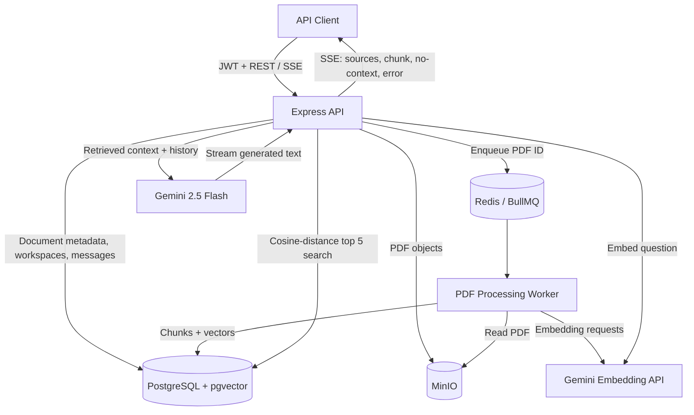
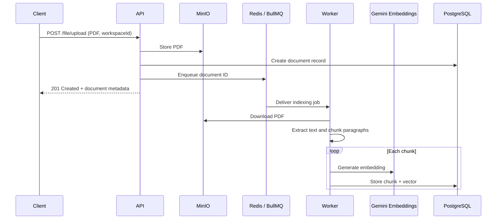
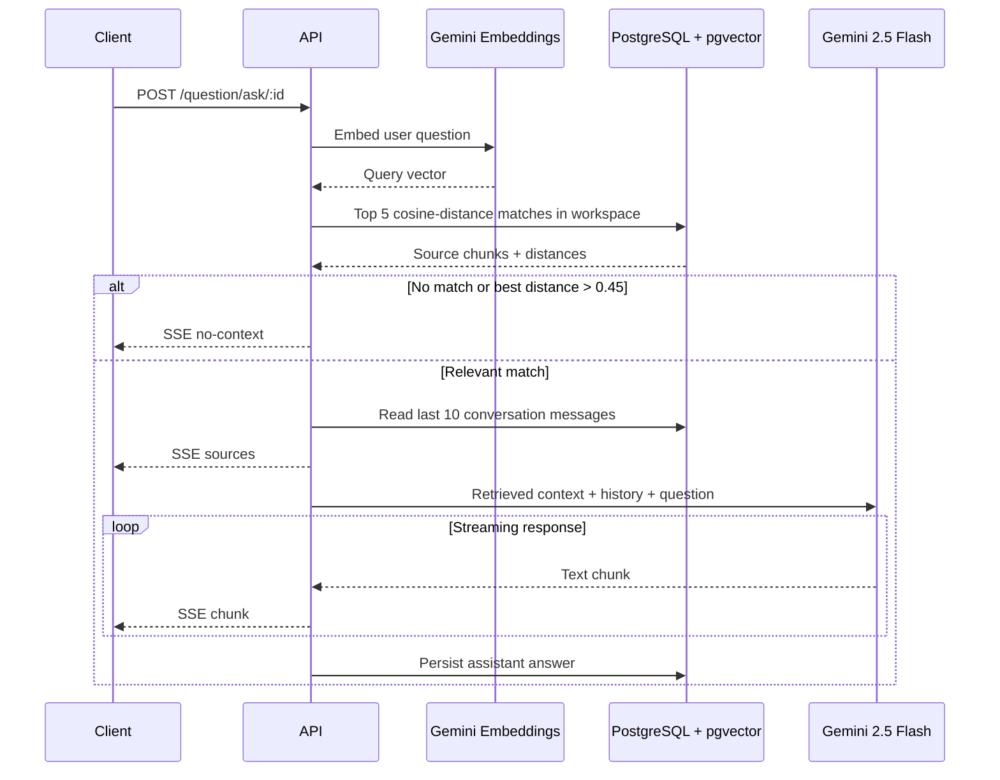

# Insight AI

**Document-grounded question answering with Retrieval-Augmented Generation (RAG).**

Insight AI is a backend-focused RAG platform that lets users upload PDFs into workspaces and ask questions about their contents. Instead of answering from the language model's general knowledge, the application retrieves relevant document passages from PostgreSQL using vector similarity search and supplies them to Google Gemini for grounded responses. Ingestion runs separately in a Redis-backed BullMQ worker; answers and source passages stream to clients using Server-Sent Events (SSE).

## Highlights

- **Document ingestion:** PDF uploads (up to **5 MiB**) stored in MinIO, with metadata in PostgreSQL.
- **Asynchronous indexing:** BullMQ/Redis worker extracts text, groups paragraphs into approximately **1,000-character chunks**, embeds them, and stores vectors.
- **Semantic retrieval:** `gemini-embedding-001` embeddings (default **3,072 dimensions**) with PostgreSQL `pgvector` cosine-distance search; retrieves **5** candidate chunks.
- **Context guardrails:** Rejects questions whose best match has cosine distance **greater than 0.45**; prompts Gemini to answer only from retrieved text.
- **Conversational Q&A:** Saves messages in PostgreSQL and includes up to **10** recent messages in subsequent questions.
- **Streaming and citations data:** Streams generated text and retrieved source-chunk metadata through SSE.
- **Workspace organization:** JWT authentication, workspace membership, and `OWNER` / `ADMIN` / `MEMBER` role definitions.
- **Job resilience:** Each document-processing job is configured for up to **5 attempts**.

> **Project scope:** This repository snapshot contains an Express API and a separate processing worker. It does not include a frontend application.

## Technology stack

| Layer | Technologies |
| --- | --- |
| HTTP API | Node.js, Express 5, JWT, Multer |
| Data access | Prisma ORM, PostgreSQL 17, pgvector |
| LLM | Google Gemini 2.5 Flash |
| Embeddings | `gemini-embedding-001` |
| Background jobs | BullMQ 5, Redis |
| Object storage | MinIO |
| Streaming | Server-Sent Events (SSE) |
| Local infrastructure | Docker Compose |

## Architecture



The **API service** handles authentication, workspace and document records, question retrieval, and streamed generation. The **worker service** independently handles CPU/network-intensive PDF parsing and embedding calls. Both services connect to the same PostgreSQL and MinIO instances; BullMQ coordinates indexing jobs through Redis.

### PDF ingestion flow



### Question-answering flow



## Repository structure

```text
.
├── docker-compose.yml             # MinIO, Redis, PostgreSQL with pgvector
├── api-services/
│   ├── index.js                  # API entry point (port 3000)
│   ├── app.js                    # Routes and middleware
│   ├── controllers/              # HTTP handlers
│   ├── services/                 # Business logic and RAG orchestration
│   ├── helpers/                  # Embeddings, retrieval, prompts, auth
│   ├── middleware/               # JWT and PDF upload validation
│   ├── routes/                   # REST endpoints
│   ├── cache/                    # BullMQ producer
│   ├── config/                   # Gemini, MinIO, Prisma, RAG settings
│   └── prisma/                   # Database schema and migrations
└── worker-services/
    ├── index.js                  # Worker entry point
    ├── services/processPdf.js    # PDF indexing workflow
    ├── helpers/chunkHelper.js    # PDF extraction and chunking
    ├── cache/                    # Worker and queue event listeners
    ├── config/                   # Service clients
    └── prisma/                   # Worker Prisma schema
```

## Configuration reference

| Setting | Value in supplied code | Notes |
| --- | --- | --- |
| Upload size limit | `5 * 1024 * 1024` bytes | Multer limit (~5 MiB) |
| PDF chunk target | `MAX_CHARS = 1000` | A single long paragraph may exceed this target |
| Embedding model | `gemini-embedding-001` | No explicit `outputDimensionality`; model default is 3,072 |
| Vector column in Prisma schema | `vector(3072)` | **Check actual DB migration state** (see below) |
| Retrieval | `LIMIT 5` | Workspace-filtered nearest chunks |
| Distance gate | `0.45` | Cosine **distance** (`<=>`), not cosine similarity |
| Conversation context | `take: 10` | Most recent messages included |
| BullMQ attempts | `5` | No custom backoff specified in snapshot |
| API port | `3000` | Hard-coded in `api-services/index.js` |

## Getting started (local development)

### Prerequisites

- Node.js and npm (use a current supported Node.js LTS release).
- Docker Engine/Desktop with Docker Compose.
- Google Gemini API key with access to `gemini-embedding-001` and `gemini-2.5-flash`.
- A local clone of this project containing `docker-compose.yml`, `api-services/`, and `worker-services/`.

### 1. Start infrastructure

From the repository root:

```bash
docker compose up -d

docker compose ps
```

The supplied Compose file exposes PostgreSQL on **5432**, Redis on **6379**, MinIO's S3 API on **9000**, and the MinIO console on **9001**. It creates persistent volumes for PostgreSQL and MinIO.

> **Security:** The supplied Compose configuration uses example database/MinIO passwords and exposes development ports. Replace these before any public deployment; never commit real secrets.

### 2. Configure both Node.js services

Create **`api-services/.env`** and **`worker-services/.env`** with values matching your local Compose configuration:

```dotenv
DATABASE_URL="postgresql://postgres:<postgres-password>@localhost:5432/AI_RAG?schema=public"
GEMINI_API_KEY="<your-gemini-api-key>"
REDIS_HOST="localhost"
REDIS_PORT="6379"
MINIO_USERNAME="<minio-root-user>"
MINIO_PASSWORD="<minio-root-password>"
JWT_SECRET="<long-random-jwt-secret>"
```

`JWT_SECRET` is needed by the API's authentication helpers; the other connection variables are used across the API/worker as applicable. The current MinIO client code uses `localhost:9000` (not environment variables for endpoint/port), so these commands assume the Node.js services run **on your host**, outside Docker. If you containerize Node.js, update the MinIO endpoint and service hostnames accordingly.

### 3. Install dependencies

Run in two terminals, or sequentially:

```bash
cd api-services
npm install
```

```bash
cd worker-services
npm install
```

### 4. Set up PostgreSQL and Prisma

Enable the pgvector extension (if not already enabled by the included migrations):

```bash
docker compose exec postgres psql -U postgres -d AI_RAG -c 'CREATE EXTENSION IF NOT EXISTS vector;'
```

**Important migration check:** The provided Prisma schemas declare `Unsupported("vector(3072)")`, but the included SQL migrations create a `vector(1536)` column. Since the embedding requests do not specify `outputDimensionality`, they use the 3,072-dimensional model default. The DB column must have the **same dimensionality** or inserts/searches may fail. Resolve this discrepancy in a reviewed migration (preserving or re-embedding any existing data) **before** indexing documents; don't blindly change a database containing real embeddings.

For a fresh database, review and reconcile the migrations first, then from `api-services/` run:

```bash
npx prisma migrate deploy
npx prisma generate
```

Generate the worker's Prisma client separately:

```bash
cd ../worker-services
npx prisma generate
```

Check the actual database type with:

```bash
docker compose exec postgres psql -U postgres -d AI_RAG -c \
  "SELECT format_type(atttypid, atttypmod) AS embedding_type FROM pg_attribute WHERE attrelid = '\"DocumentChunk\"'::regclass AND attname = 'embedding';"
```

Expected type for the **current default embedding calls**: `vector(3072)`.

### 5. Run the API and worker

Terminal A:

```bash
cd api-services
node index.js
```

Terminal B:

```bash
cd worker-services
node index.js
```

API base URL: **`http://localhost:3000`**. The API's startup code creates the MinIO bucket named `files` if necessary. Start the API before uploading documents; keep the worker running for background indexing.

> **Snapshot caveat:** The provided `worker-services/cache/pdfQueueEvents.js` ends with `module.exports - pdfQueueEvents;` rather than an assignment. Replace this with `module.exports = pdfQueueEvents;` if you encounter a startup error. Also review the workspace membership service before relying on role-management endpoints: some calls omit `workspaceId`, and the membership helper currently returns a boolean while role checks expect a member object.

## API overview

All routes below are as declared in the provided Express source. Authenticated routes require `Authorization: Bearer <JWT>`.

| Method | Endpoint | Purpose |
| --- | --- | --- |
| `POST` | `/api/users/register` | Create user (`username`, `password`) |
| `POST` | `/api/users/login` | Obtain JWT (`username`, `password`) |
| `POST` | `/workspace/add` | Create workspace (`name`) |
| `POST` | `/workspace/remove` | Delete owned workspace (`workspaceId`) |
| `POST` | `/member/add` | Add workspace member |
| `POST` | `/member/update` | Change member role |
| `POST` | `/member/remove` | Remove workspace member |
| `POST` | `/file/upload` | Upload PDF as multipart `file` + `workspaceId` |
| `POST` | `/conversation/` | Create conversation (`workspaceId`, optional `title`) |
| `POST` | `/question/ask/:id` | Ask a question in a conversation; returns SSE |

### Example API flow

**Register:**

```bash
curl -X POST http://localhost:3000/api/users/register \
  -H 'Content-Type: application/json' \
  -d '{"username":"demo","password":"replace-this-password"}'
```

**Log in:**

```bash
curl -X POST http://localhost:3000/api/users/login \
  -H 'Content-Type: application/json' \
  -d '{"username":"demo","password":"replace-this-password"}'
```

Copy the `token` from the login response into your shell:

```bash
export TOKEN="<jwt-from-login>"
```

**Create a workspace:**

```bash
curl -X POST http://localhost:3000/workspace/add \
  -H "Authorization: Bearer $TOKEN" \
  -H 'Content-Type: application/json' \
  -d '{"name":"Research"}'
```

Copy the returned workspace ID:

```bash
export WORKSPACE_ID="<workspace-id>"
```

**Upload a PDF:**

```bash
curl -X POST http://localhost:3000/file/upload \
  -H "Authorization: Bearer $TOKEN" \
  -F "workspaceId=$WORKSPACE_ID" \
  -F 'file=@./sample.pdf;type=application/pdf'
```

The upload endpoint returns a document record after queuing processing, **not** after indexing completes. Check worker logs for the job's completion before asking questions about the document.

**Create a conversation:**

```bash
curl -X POST http://localhost:3000/conversation/ \
  -H "Authorization: Bearer $TOKEN" \
  -H 'Content-Type: application/json' \
  -d "{\"workspaceId\":$WORKSPACE_ID,\"title\":\"Document Q&A\"}"
```

**Ask a question and receive SSE:**

```bash
export CONVERSATION_ID="<conversation-id>"
curl -N -X POST "http://localhost:3000/question/ask/$CONVERSATION_ID" \
  -H "Authorization: Bearer $TOKEN" \
  -H 'Content-Type: application/json' \
  -d "{\"workspaceId\":$WORKSPACE_ID,\"question\":\"What are the main findings?\"}"
```

Possible event names are `sources`, `chunk`, `no-context`, and `error`. The `sources` event includes retrieved chunk content and metadata (including cosine distance). `chunk` events carry streamed model text. The code doesn't currently send a separate named `done` event; the connection closes after processing.

## How retrieval stays grounded

1. Embed the question using `gemini-embedding-001`.
2. Filter document chunks by **workspace ID** and sort by pgvector's `<=>` **cosine distance** operator.
3. Retrieve the five closest chunks.
4. Check the **best** chunk: if it has distance > `0.45`, return `no-context`. The threshold is **not** applied to each of the other four chunks individually in the current implementation.
5. Load the last ten messages, combine the retrieved chunk content with the question, and call `gemini-2.5-flash` with a document-only instruction.
6. Stream the answer and persist the user and assistant messages.

These mechanisms reduce unsupported answers but do **not** guarantee factual correctness. The current query performs an ordered vector search; no HNSW or IVFFlat vector index is declared in the supplied migrations.

## Operational notes and limitations

- **Embedding/schema consistency:** Confirm whether the deployed database uses 1,536 or 3,072 dimensions before ingestion. Any change in dimension requires consistent embedding calls and database storage, plus a migration/re-embedding plan for existing chunks.
- **Worker retries:** Up to five attempts are configured, without explicit exponential backoff. Partial chunks can be recreated because the processing routine deletes existing chunks before reinserting them.
- **Indexing status:** Queue event logging is available, but this snapshot does not expose a dedicated document-indexing status endpoint.
- **Chunk boundaries:** Chunking is paragraph-based and targets 1,000 characters; unusually long single paragraphs are not split further.
- **Response safety:** Document-only prompting and retrieval thresholds help, but additional evaluation and prompt-injection defenses are recommended before production use.
- **Authorization:** Workspace membership checks are present; review and test member-role operations before deployment. CORS is currently enabled without a restrictive origin policy.
- **Deployment:** Compose provisions infrastructure only; API and worker are started manually. Add secrets management, health checks, observability, rate limiting, and CI/CD for production.

## Roadmap

- Hybrid search (keyword + vector) and metadata filtering.
- Better chunking strategies, embedding cache, and re-indexing controls.
- Vector indexing and retrieval quality evaluations at scale.
- DOCX, TXT, and Markdown ingestion.
- Multi-document ranking, citation-friendly source metadata, and indexing status endpoints.
- Conversation summarization and agent-based workflows.

## What this project demonstrates

The goal is to implement the fundamentals of RAG directly—**embedding generation, chunking, pgvector retrieval, context-constrained prompting, asynchronous job processing, persistent conversation history, and SSE streaming**—without relying on an end-to-end RAG framework.

---

**License:** No license file was included in the supplied repository snapshot; add one if you intend to publish the project under an open-source license.
